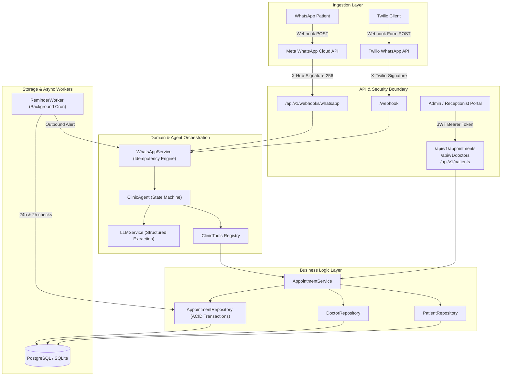

# System Architecture Document

**Platform:** AI-Powered Clinic Automation Platform  
**Architecture Style:** Layered Domain-Driven Clean Architecture  
**Runtime:** Python 3.11+, FastAPI, SQLAlchemy 2.0, PostgreSQL / SQLite  

---

## 1. High-Level System Architecture

---

## 2. Layered Responsibilities

### 2.1 API Ingestion Layer (`app/api/`)
- Exposes typed REST endpoints using FastAPI and Pydantic v2 schemas.
- Ingests inbound webhooks from both Meta WhatsApp Cloud API and Twilio.
- Cryptographically validates webhook signatures prior to payload processing.
- Handles HTTP status codes, structured errors, and CORS middleware.

### 2.2 Security & Authentication Layer (`app/core/security.py`, `app/services/auth_service.py`)
- Bcrypt password hashing (cost factor 12).
- Signed JWT token issuance with role-based claims (`ADMIN`, `RECEPTIONIST`, `DOCTOR`).
- Enforces strict patient isolation: patients cannot cancel or reschedule appointments belonging to another phone number.

### 2.3 Agent & Tool Calling Architecture (`app/agents/`)
- **Strict Separation of Decision and Execution**: The LLM NEVER directly queries or alters the database.
- The LLM classifies user intent into structured Pydantic schemas (`IntentExtractionResult`).
- The backend orchestrator (`ClinicAgent`) maps intents to typed tools (`ClinicTools`), verifies permissions, and executes atomic database transactions.
- Explicit patient confirmation is mandatory prior to committing bookings or cancellations.

### 2.4 Data Repository & Concurrency Control (`app/repositories/`)
- Relational schema with foreign keys, indexes, and unique constraints.
- Prevents double booking via atomic slot queries within transactional boundaries (`SELECT ... FOR UPDATE` in PostgreSQL).
- Provides idempotency keys to ignore re-transmitted webhook payloads.

### 2.5 Background Asynchronous Worker (`app/workers/`)
- Evaluates appointments 24 hours and 2 hours prior to scheduled consultation times.
- Dispatches proactive WhatsApp reminder alerts.
- Transactionally records reminder state to guarantee zero duplicate messages.
- Filters out cancelled or rescheduled appointments automatically.
