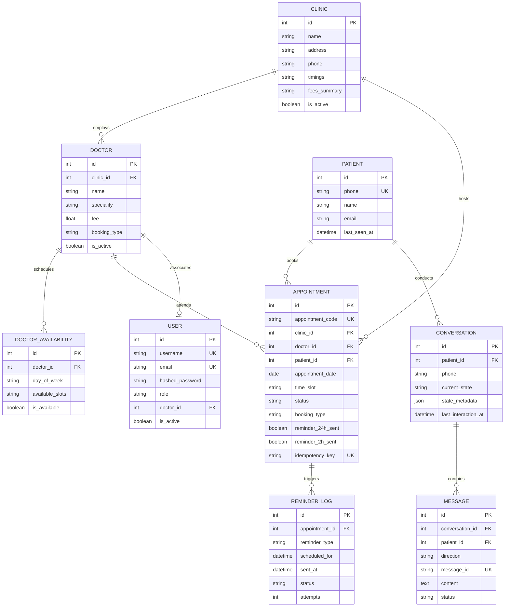

# Database Design & Concurrency Model

**Database:** PostgreSQL 16+ (Production) / SQLite 3.38+ (Local Dev & Automated CI)  
**ORM:** SQLAlchemy 2.0  
**Migration Engine:** Alembic  

---

## 1. Entity-Relationship Model

---

## 2. Concurrency Safety & Anti-Double-Booking Architecture

### The Problem in Legacy Prototypes:
In the original Google Sheets prototype, checking slot availability and appending an appointment were distinct, unsynchronized operations. Under concurrent requests:
1. Patient A and Patient B ask for Dr. Sharma at 10:00 AM on Monday.
2. Both requests read Google Sheets simultaneously; both see the slot as free.
3. Both append rows. The doctor is now double-booked.

### The Production Solution:
1. **Compound Index**: An index on `(doctor_id, appointment_date, time_slot)` provides indexed query speeds.
2. **Atomic Transaction Isolation**:
   - In `AppointmentRepository.create_atomic`, the slot check query executes inside an active database transaction.
   - For PostgreSQL engines, `with_for_update()` acquires a row-level lock on existing records matching the criteria.
   - Any concurrent transaction attempting to book the identical slot encounters a collision and aborts with `DoubleBookingError`.
3. **Idempotency Keys**: Requests carrying unique `idempotency_key` headers return the existing booking record rather than re-executing.
