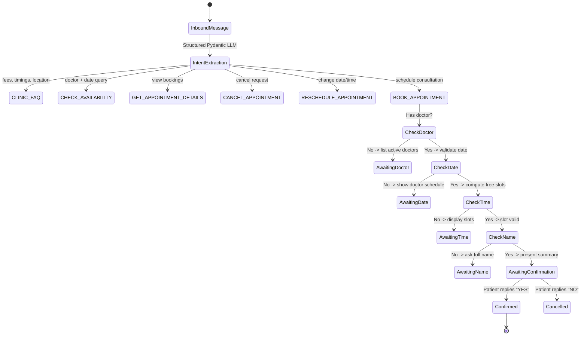

# GenAI & Agentic Design Document

**Engine:** OpenAI (`gpt-4o-mini`) / Gemini API with Deterministic Heuristic Fallback  
**Framework:** Pydantic Structured Outputs + Native Tool Registry  
**Pattern:** Deterministic State Machine with Tool Calling Orchestration  

---

## 1. Design Philosophy: Why NOT an Autonomous Unconstrained Agent?

Many prototype AI agents use unrestricted LangChain/ReAct loops where the LLM is given database access and decides when to stop looping. In healthcare and appointment scheduling, this approach causes:
1. **Hallucinated Availability**: The model invents time slots that do not exist.
2. **Infinite Loops & High Cost**: The model gets stuck in repeated tool calls on ambiguous queries.
3. **Safety & Liability Risks**: The model offers medical diagnoses or advises unverified treatments.

### The Production Approach:
- **Strict Separation of Decision and Execution**: The LLM classifies intent and extracts entities into typed Pydantic models.
- **The Backend is the Single Source of Truth**: Availability calculation, double-booking prevention, and state persistence are executed exclusively by Python services and database transactions.
- **Deterministic State Machine**: When details are missing (e.g. date or time), the state machine advances to `AWAITING_DATE` or `AWAITING_TIME` and prompts the patient directly.
- **Mandatory Patient Confirmation**: Before any booking is persisted, the state machine requires an explicit `YES` from the patient.

---

## 2. Intent Classification Architecture

---

## 3. Tool Calling Registry

The platform exposes 7 typed tools under `ClinicTools` (`app/agents/tools.py`):
1. `check_doctor_availability(doctor_name, date)`: Dynamic slot calculation based on weekly schedule minus active bookings.
2. `get_doctor_details(doctor_name)`: Returns doctor speciality, consultation fees, and working days.
3. `get_clinic_information(query_type)`: Verified clinic address, timings, and policies.
4. `book_appointment(patient_phone, doctor_name, date, time, confirmed_by_patient)`: Atomic booking with double-booking prevention.
5. `reschedule_appointment(appointment_code, new_date, new_time, patient_phone)`: Atomically updates appointment after ownership verification.
6. `cancel_appointment(appointment_code, patient_phone, reason)`: Cancels appointment after ownership verification.
7. `get_patient_appointments(patient_phone)`: Queries verified upcoming bookings for caller ID.
